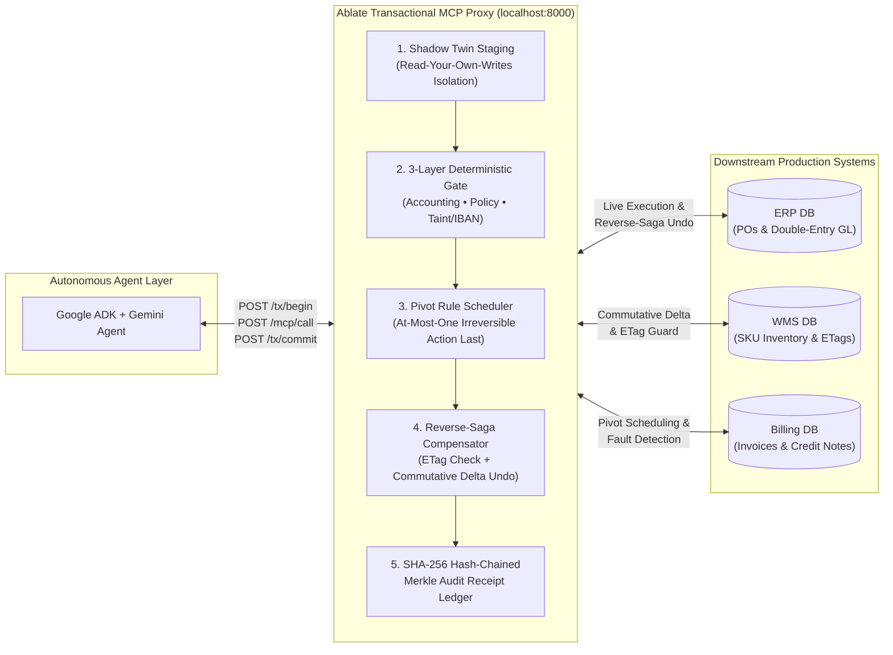

# Ablate

**Transactional MCP Staging Proxy, Deterministic Invariant Gate, and Automatic Reverse-Saga Rollback Engine for Autonomous AI Agents.**

Built for **Google Startup Buildathon India 2026**.

---

## The Problem: Multi-System Agent Partial Corruption

Enterprise AI agents built with **Google ADK + Gemini** do not execute single-system read queries—they execute multi-step workflows that mutate state across heterogeneous SaaS systems (ERP, WMS, Billing) via **Model Context Protocol (MCP)** tool calls.

Because third-party SaaS APIs (SAP, NetSuite, Manhattan WMS, Stripe) **never expose distributed two-phase commit (`2PC` / `XA`) locks** over REST/MCP, autonomous agents suffer from **non-atomic partial failure**:
1. **Mid-Flight API Faults (`409 Conflict` / `429` / `503`)**: An agent updates ERP Purchase Orders and deducts WMS Inventory, then hits a `409 Conflict` on Billing Invoice creation. Result: **orphaned ledger entries and phantom inventory drain across live production systems**.
2. **Indirect Prompt Injection**: Untrusted supplier emails or invoice payloads hijack the agent's context to swap payout IBANs or inflate line-item quantities mid-transaction.
3. **Concurrent Human Edits (Lost-Update Race)**: A human warehouse operator adjusts stock while an agent transaction is in flight; naive snapshot rollbacks overwrite the human's edit.

---

## The Solution: Ablate

**Ablate** sits transparently between any MCP-compatible agent runtime and downstream enterprise tools, bringing **ACID-like transactional guarantees, taint-tracked security invariants, and sub-400ms automatic Reverse-Saga rollbacks** to non-transactional APIs.

### Architecture



---

## Core Technical Pillars

### 1. Ephemeral Shadow Twin Staging (Read-Your-Own-Writes)
When an agent opens a transaction (`POST /tx/begin`), Ablate clones the relevant state slices into an isolated **Shadow Twin**. Every `POST /mcp/call` mutates and reads from the Shadow Twin first:
- The agent sees its own uncommitted writes across multi-step reasoning turns.
- **Zero live database writes** occur during staging (`0` dirty bytes reach production if the agent hallucinates or aborts early).

### 2. 3-Layer Deterministic Invariant Gate
Before any staged transaction is promoted to live execution (`POST /tx/commit`), Ablate evaluates three deterministic invariant layers against the post-mutation Shadow Twin:
- **Layer 1 — Accounting & Physical Conservation (`ledger_balance`, `inventory_non_negative`)**: Double-entry General Ledger debits must equal credits ($\sum \text{Debit} - \sum \text{Credit} = 0$), and no SKU's `on_hand` or `available` count may drop below `0`.
- **Layer 2 — Enterprise Policy & Dollar Cap (`dollar_cap`)**: Transactions exceeding `max_auto_usd` (default `$25,000`) are deterministically halted and transitioned to `ESCALATED_HITL` for human approval.
- **Layer 3 — Provenance Taint & IBAN Integrity (`iban_integrity`, `taint_check`)**: Fields derived from untrusted external context (`tainted_fields`) cannot modify high-privilege sinks (e.g., beneficiary IBANs or payout routing), neutralizing indirect prompt injection in shadow before a single live packet leaves the proxy.

### 3. The Pivot Rule (Handling Irreversible Actions)
Every MCP tool in Ablate's catalog is classified by reversibility:
- `REVERSIBLE`: Supports deterministic compensation (e.g., reversing GL journal entries, restoring PO status, applying commutative inventory deltas, issuing credit notes).
- `PIVOT`: Irreversible external side effects (e.g., `billing.send_wire_payout`).
- **Schedule Law**: Ablate enforces **at most one `PIVOT` tool per transaction** (`PIVOT_LIMIT_EXCEEDED` if $\ge 2$) and topologically sorts the `PIVOT` operation to execute **strictly last**, after all reversible mutations and invariant checks have succeeded.

### 4. Optimistic Concurrency (ETag) & Commutative Delta Reverse-Saga
If a downstream API fails mid-commit (e.g., Billing returns `HTTP 409 Conflict`), Ablate triggers an automatic **Reverse-Saga Rollback** in lifo order:
- **Commutative Delta Compensation**: For numeric counters like WMS inventory, Ablate applies inverse deltas (`+delta`) rather than blindly restoring old snapshots—preserving concurrent human stock adjustments.
- **ETag Conflict Quarantine**: For non-commutative records (e.g., ERP Purchase Orders), Ablate verifies the record's cryptographic `etag` / version before applying compensation. If a human edited the record mid-flight, Ablate halts automatic overwrite and flags `QUARANTINED_CONCURRENT_EDIT` so human data is never clobbered.

### 5. Cryptographic State Proofs & Hash-Chained Audit Receipts
Every transaction produces a tamper-evident `TxReceipt` containing:
- `pre_tx_hashes` and `post_tx_hashes` (SHA-256 digests of ERP, WMS, and Billing state).
- `hashes_match: true` mathematical proof that a rolled-back or shadow-aborted transaction left live production state bit-for-bit identical to pre-transaction state.
- `prev_hash` and `receipt_hash` forming an immutable hash chain across the session ledger.

---

## Local Quickstart

### 1. Start the Ablate Runtime & Mock Enterprise Services
```bash
python run_all.py
```
This launches the Ablate Transactional Proxy and the 3 stateful enterprise databases (ERP, WMS, Billing) on `http://localhost:8000`.

### 2. Launch the Split-Screen Mission Control UI
```bash
cd ui && npm install && npm run dev
```
Open the Mission Control dashboard (default `http://localhost:5173`). You can configure the backend URL via `VITE_API_URL` (defaults to `http://localhost:8000`).

### 3. Run the Automated Verification & 15-Episode Benchmark Suite
```bash
pytest -v -s
```
Runs 5 verification suites (`test_shadow_and_invariants.py`, `test_pivot_rule.py`, `test_saga_rollback.py`, `test_etag_conflict_guard.py`, and the 15-episode `test_bench_suite.py` comparing **Ablate OFF vs. Ablate ON**).

---

## Guarantees & Honest Operational Limits

| Failure Mode / Scenario | Without Ablate (Direct MCP) | With Ablate Proxy ON | Mechanism & Honest Boundary |
| :--- | :--- | :--- | :--- |
| **Mid-Flight Downstream `409 / 500` Fault** | Partial corruption across previously mutated DBs | `ROLLED_BACK_CLEANLY` (`100%` hash parity in `<400ms`) | Reverse-Saga LIFO compensation restores ERP & WMS state |
| **Double-Entry GL Imbalance / Negative Stock** | Corrupts production ledger or over-allocates stock | `ABORTED_IN_SHADOW` (`0` live writes) | Layer-1 conservation invariant check in Shadow Twin |
| **Indirect Prompt Injection (IBAN Swap)** | Exfiltrates wire payout to attacker IBAN | `ABORTED_IN_SHADOW` (`0` live writes) | Layer-3 taint propagation + approved vendor IBAN registry |
| **Unauthorized High-Value Payout (`>$25k`)** | Executes autonomously without human sign-off | `ESCALATED_HITL` (`0` live writes) | Layer-2 policy cap holds staged tx for human approval |
| **Multiple Irreversible Actions in 1 Tx** | Partial irreversible side effects if 2nd fails | Rejected upfront (`PIVOT_LIMIT_EXCEEDED`) | Pivot Rule enforces $\le 1$ irreversible tool sorted last |
| **Concurrent Human Edit on Inventory (WMS)** | Snapshot rollback overwrites human stock count | Preserves human edit + undoes agent delta | Commutative delta compensation (`-\Delta \rightarrow +\Delta`) |
| **Concurrent Human Edit on PO Status (ERP)** | Rollback silently clobbers human PO override | `QUARANTINED_CONCURRENT_EDIT` (human edit preserved) | Optimistic ETag verification halts unsafe compensation |
| **Hidden Internal ERP DB Triggers** | Unobserved side effects inside closed SaaS | Compensates API-visible state; requires trigger spec | Ablate operates at the MCP/API contract layer, not raw SQL |

---

## Revenue Model Hypothesis

Ablate monetizes as **Transactional Infrastructure for Enterprise Agent Fleets**:
1. **Usage-Based Protected Transaction Metering**: `$0.02 – $0.05` per committed or compensated multi-system MCP transaction (scales directly with autonomous back-office task volume in procurement, order-to-cash, and supply chain).
2. **Enterprise Compliance & Audit Plane (Annual Platform License)**: `$48,000+/yr` for SOC2/SOX cryptographic `TxReceipt` retention, SIEM/OpenTelemetry streaming, custom Rego/CEL invariant packs, and Human-in-the-Loop (HITL) quarantine queues.
3. **Zero-Lock-In GTM Wedge**: Drops in as a 1-line MCP gateway proxy (`VITE_API_URL` / MCP transport endpoint) compatible with Google ADK, LangGraph, and Vertex AI Agent Builder without rewriting agent prompts.
